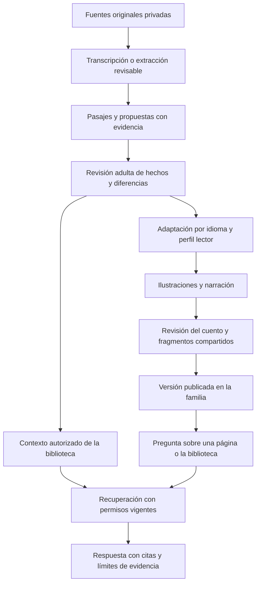

# Arquitectura de LivingMemories

## Base existente y alcance del diseño

El repositorio contiene Next.js 16.4.0 con App Router, React 19.3.0, Prisma 7.10.0, PostgreSQL 18.6 y Better Auth 1.7.7. El esquema incluye autenticación, familias, narradores, `MemoryCollection`, `Memory`, `MemorySource`, `StoryPreparation` y sus referencias de fuentes. Los servicios comprueban sesión, membresía y autoría vigentes.

El entorno Docker conecta PostgreSQL/pgvector, MinIO privado, Mailpit, worker/pg-boss, app y Nginx. El acceso, captura básica de memorias y preparación de cuentos están implementados; los originales se guardan en MinIO y se leen mediante rutas autorizadas. No hay todavía índices de contenido ni handlers de generación. Los contratos de revisión, procesamiento y publicación siguen como diseño de implementación.

## Componentes y estado

| Componente | Responsabilidad | Estado |
| --- | --- | --- |
| Aplicación Next.js | Entrada, memorias, álbumes y preparación de cuentos | Captura, contexto y generación privada por etapas implementados; publicación y revisión estructurada pendientes |
| Servicios de dominio | Permisos, revisiones, versiones y publicación | Permisos de originales y preparaciones implementados; hechos/publicación pendientes |
| PostgreSQL y Prisma | Metadatos, relaciones, evidencia y procesos | Memorias/fuentes/preparaciones implementadas; evidencia versionada pendiente |
| Almacenamiento privado MinIO | Originales, fragmentos y medios | Texto y archivos originales autorizados implementados; derivados y fragmentos pendientes |
| Worker Node.js y pg-boss | Base para transcripción, OCR, generación e indexación | Colas de diagnóstico y creaciones implementadas; OCR/indexación pendientes |
| PostgreSQL textual y pgvector | Pasajes relevantes con permisos y procedencia | Extensión activada; índices/documentos pendientes |
| Adaptadores OpenAI y ElevenLabs | Contratos por capacidad, modelos de DEC-024 | Integraciones pendientes |
| Nginx | Entrada a app y servicios autorizados | Configurado para la app local |
| Mailpit | Captura local de invitaciones/correos de prueba | Invitaciones y fallos de entrega gestionados; no entrega externa |

Next.js conserva las comprobaciones de sesión y permisos junto a las operaciones de servidor. Un identificador familiar enviado por el navegador se valida contra la membresía; no se confía en el cliente para declarar autoría o privilegios. Los servicios de dominio deben reutilizar la misma política en APIs, worker, búsquedas y reproducción de archivos.

## Modelo conceptual de datos

| Grupo | Entidades propuestas y relaciones |
| --- | --- |
| Participación | `Family`, `Membership`, `Invitation`; una cuenta puede pertenecer a distintas familias, con contexto activo explícito |
| Personas | `PersonProfile`, vinculado opcionalmente a una cuenta; la atribución del narrador es distinta de la autoría de captura |
| Recuerdos | `Memory`, `Source`, `SourceVersion`; una memoria tiene fuentes y un narrador o testimonios identificados |
| Evidencia | `TranscriptVersion`, `EvidenceSpan`, `ReviewedFact`, `FactRevision`, `Review`; un dato puede tener varios testimonios, localizadores y estados |
| Entrevista | `Interview`, `InterviewTurn`; cada respuesta relevante añade una fuente atribuida |
| Biblioteca | `LibraryDocument`, `Collection`, `Tag`, `RetrievalChunk`; documentos y memorias referencian fuentes conservadas |
| Cuentos | `Story`, `StoryVersion`, `StoryPage`, `GeneratedAsset`, `Publication`; cada versión tiene memoria principal, idioma, perfil y dependencias revisadas |
| Consultas | `Conversation`, `ConversationTurn`, `AnswerCitation`; separadas del cuento y sujetas a permisos actuales |
| Procesamiento | `GenerationRun`, `ProcessingJob`, `ProviderAttempt`; registran estado, versión de instrucciones, proveedor y resultados |

Las relaciones entre datos familiares deben conservar `familyId` o una asociación verificable con la familia, y no admitir referencias cruzadas por un simple identificador. Los campos definitivos, restricciones e índices se especificarán al implementar cada módulo, antes de crear su migración.

La captura actual usa `MemorySource` para los originales inmutables y su contexto manual. `MemoryCollection` agrupa recuerdos sin destruirlos al eliminar el álbum. `StoryPreparation` conserva una memoria principal y referencias relacionales a materiales autorizados; no sustituye las futuras versiones de hechos o cuentos generados. El detalle de la [adaptación de UX](../ux-reference-adaptation.md) distingue lo implementado de lo pendiente.

Un localizador de evidencia identifica una versión y un pasaje: tiempo inicial/final de audio, rango de texto o página/región de documento. Una corrección humana crea una aportación atribuida. El texto confirmado no se hace pasar por una cita literal de la grabación.

## Flujo desde las fuentes al cuento

Las versiones conservan las fuentes, datos, decisiones de revisión y medios que utilizaron. Cambiar el texto hace que su narración quede desactualizada; cambiar una referencia visual puede requerir regenerar las ilustraciones afectadas. La publicación identifica un conjunto completo aprobado, no los últimos archivos disponibles por separado.

Cambiar una fuente o dato usado marca los derivados como `requiere revisión`; retirar una fuente imprescindible suspende su acceso por lectores y RAG hasta revisar el derivado. DEC-017 fija papelera de 30 días y purga, con caducidad de respaldos en otros 30 días como máximo. El retiro se aplica antes de actualizar índices y también al restaurar respaldos. Estas reglas están definidas; el mecanismo aún no existe.

## Permisos y proyecciones compartidas

La matriz está confirmada en [DEC-014](decisions.md#dec-014): administradores, colaboradores sobre sus propias memorias y lectores. Un comando privado habilita al primer administrador; enlaces ligados al correo duran 7 días y se usan una vez. Debe permanecer al menos un administrador, incluso ante cambios concurrentes de membresías. El administrador y el autor pueden consultar originales; el lector consulta cuentos publicados y fragmentos aprobados. El historial es privado del adulto que conversa, sin acceso administrativo automático.

Publicar un cuento prepara una proyección de su texto, hechos y evidencia permitida. Publicar un fragmento de audio crea un archivo recortado independiente; un enlace con un intervalo temporal sobre el original no es suficiente. Los fragmentos textuales e imágenes se sirven con el mismo límite de alcance.

Las fotografías de referencia no se exponen automáticamente por aparecer una ilustración basada en ellas. Sus permisos siguen siendo los de las fuentes originales.

Las descargas privadas del lector pasan por una operación que comprueba permisos vigentes en cada nueva solicitud. No se entrega una URL directa de lectura que siga funcionando después de retirar su permiso. La política evita nuevos accesos y reutilización en RAG; no puede borrar lo que una persona ya escuchó o descargó legítimamente antes de la retirada.

## Recuperación de contexto

La recuperación combinará búsqueda textual de PostgreSQL y pgvector con `text-embedding-3-small` de 1.536 dimensiones. La extensión ya está instalada y activada mediante una migración; índices, documentos y recuperación con permisos siguen en TASK-007. Los cambios de modelo/dimensiones requieren reindexación explícita.

1. Validar sesión, familia activa, contexto del cuento y permisos de consulta.
2. Recuperar candidatos filtrados por familia, visibilidad, estado y versión. La política se aplica dentro de la recuperación, no después de entregar contenido al modelo.
3. Para un lector, recuperar únicamente texto publicado, pasajes y proyecciones aprobadas; nunca el resto del original o su transcripción completa. Para autor y administrador, ampliar solo al material que pueden consultar.
4. Mantener separados testimonio familiar y contexto documental. Un documento cultural no rellena datos biográficos faltantes.
5. Generar una respuesta apoyada en esos pasajes y validar que las citas correspondan a evidencia accesible. Si no alcanza, devolver evidencia insuficiente.
6. Comprobar permisos al abrir una cita y al reutilizar contexto de turnos anteriores. Incluir versiones de permisos y fuentes en la política de caché.

Los índices, prompts y resúmenes también contienen información derivada y deben respetar las restricciones de sus originales. Indexar toda la biblioteca no implica proporcionar todo su contenido a cada usuario. Un documento o una grabación se trata como datos; sus instrucciones no pueden habilitar herramientas, modificar permisos ni aprobar hechos.

## Contratos internos propuestos

Los contratos definen capacidades, no SDKs ni modelos obligatorios. Se validan con esquemas estructurados y casos de proveedor simulados antes de integrar llamadas reales.

| Capacidad | Entrada esencial | Salida esencial |
| --- | --- | --- |
| Almacenamiento | Actor, familia, tipo y metadatos de carga | Referencia privada verificada; lectura con permiso y alcance |
| Transcripción | Referencia de audio autorizada e idioma conocido si existe | Texto y segmentos con tiempos; metadatos del proveedor |
| Extracción documental | Versión de PDF, imagen o texto | Pasajes con páginas/regiones, extracción revisable y errores |
| Entrevista | Memoria, respuestas y contexto autorizado | Pregunta siguiente; ningún hecho confirmado automáticamente |
| Extracción de hechos | Pasajes y testimonios localizados | Propuestas, referencias, incertidumbres y diferencias |
| Adaptación narrativa | Memoria principal, revisión de hechos, contexto permitido, idioma y perfil | Páginas propuestas con respaldo de las afirmaciones relevantes |
| Ilustración | Página, referencias fotográficas autorizadas y guía visual | Resultado o identificador asíncrono del proveedor |
| Narración | Texto versionado, idioma y voz elegida | Audio y alineación cuando esté disponible |
| Recuperación y respuesta | Actor, contexto, pregunta y pasajes permitidos | Respuesta, citas y estado de respaldo; sin mutación del cuento |

Las rutas de acceso están enumeradas en la [guía de acceso](../access.md). `/api/families/:familyId/content/*` cubre álbumes, memorias, carga/lectura de originales, contexto manual, papelera y preparaciones. Entrevistas, revisión de hechos, generación y publicación se diseñarán en sus tareas.

El entorno usa MinIO privado fuera de `public/`. Las cargas y nuevas lecturas verifican familia, membresía y autoría; la respuesta de archivos no usa URLs públicas. Bytes y cantidad se limitan en el servidor. La validación técnica completa de formatos/duración, procesamiento y purga siguen en TASK-003/005/012. El worker incluye herramientas multimedia, todavía sin conectarlas a esos procesadores.

## Procesamiento, errores y costo

El diseño usa un worker Node.js separado de las peticiones web, con pg-boss sobre PostgreSQL en Docker. Cada proceso conserva su entrada versionada, resultado y dependencias. El navegador puede conocer el progreso y recuperar una sesión sin mantener abierta una generación larga.

Una clave de idempotencia relaciona capacidad, versión de entrada y opciones relevantes. Antes de repetir una llamada se comprueba si existe resultado o identificador del proveedor. Un timeout con resultado desconocido se reconcilia antes de reenviar; la cola por sí sola no garantiza que el proveedor no cobre una segunda solicitud.

El primer entorno local consulta el estado de generaciones sin exponer un callback público. Si un despliegue posterior incorpora callbacks, deberá verificar autenticidad, identificador y estado y tolerar eventos repetidos o fuera de orden. Los archivos finales se guardan bajo control de la app; una URL temporal del proveedor no es el almacenamiento permanente del cuento.

Los errores distinguen archivo no admitido, evidencia insuficiente, procesamiento transitorio, resultado inválido, saldo insuficiente y servicio no disponible. Un fallo preserva originales, respuestas y resultados anteriores. Nunca publica automáticamente un borrador.

Los topes son US$5 por versión, US$25 por adulto/familia al mes y US$100 por app al mes, con reservas atómicas en todos los niveles aplicables. Las regeneraciones por página o audio están limitadas a 2 y consumen el mismo presupuesto. Un ajuste de extensión o de perfil muestra su nueva estimación antes de gastar. Las suscripciones y el consumo fuera de la app no quedan limitados por esta contabilidad interna.

Texto y citas de conversaciones persisten hasta que el adulto los elimine; los audios de preguntas y respuestas se retiran del almacenamiento activo a los 7 días. Al visualizar o reutilizar historial se verifican permisos actuales y se oculta contenido derivado de fuentes retiradas. Las grabaciones originales de memorias no son audio conversacional y no caducan por esa regla.

## Requisitos transversales

### REQ-SYS-001

**Autorización y archivos privados.** Cada operación de servidor y cada lectura de archivo comprueba acceso. Índices, caches, logs y derivados no pueden eludir las restricciones de una fuente.

Aceptación: las pruebas cruzadas de familia y alcance fallan sin revelar contenido restringido; logs de fallos no contienen secretos ni transcripciones completas. [SCN-01](validation.md#scn-01), [SCN-10](validation.md#scn-10), [SCN-12](validation.md#scn-12). Tarea: [TASK-003](tasks.md#task-003).

### REQ-SYS-002

**Procesamiento recuperable.** Las operaciones largas conservan estados y resultados, admiten recuperación parcial y reconcilian solicitudes ambiguas antes de repetirlas.

Aceptación: una interrupción de worker o callback duplicado no pierde originales ni publica resultados parciales; reintentar una ilustración no regenera otras completadas. [SCN-13](validation.md#scn-13), [SCN-17](validation.md#scn-17). Tarea: [TASK-004](tasks.md#task-004).

### REQ-SYS-003

**Trazabilidad de AI y medición del piloto.** Cada ejecución registra capacidad, proveedor, modelo, versión de instrucciones, duración, estado y uso/costo cuando pueda conocerse. Se distinguen costo estimado, costo informado y costo desconocido.

Aceptación: puede investigarse un cuento y sus regeneraciones sin almacenar secretos en logs; un valor desconocido no se interpreta como gasto cero. Los límites aprobados se aplican antes de generar. [SCN-13](validation.md#scn-13), [SCN-17](validation.md#scn-17). Tarea: [TASK-004](tasks.md#task-004).

Las referencias oficiales y sus alcances se conservan en [decisions.md](decisions.md#referencias-oficiales). Las migraciones y compatibilidades se validarán en bases de desarrollo independientes antes de preparar el piloto.

## Creaciones privadas desde álbumes (DEC-026)

`MusicPreparation` y sus fuentes acompañan a `StoryPreparation`. Ambas producen versiones `Creation`, con configuración/modelos, contexto de fuentes, borrador revisable, archivos privados y referencias `CreationSource`. El worker procesa medios y dos etapas en pg-boss: borrador → revisión → medios. OpenAI recibe texto e imágenes normalizadas/fotogramas, y ElevenLabs recibe audio derivado para Scribe, texto aprobado para TTS o dirección/plan musical aprobado para Music. No se comparten URLs públicas de MinIO ni se envían materiales de álbumes no seleccionados. Cada llamada y lectura de resultado vuelve a comprobar permisos.

La reserva de US$5 se serializa entre familias para controlar el cupo local. No concilia todavía facturación externa. Fallos no tienen reintentos pagados automáticos; se conservan resultados parciales. [Detalles y límites](../content-generation.md).
